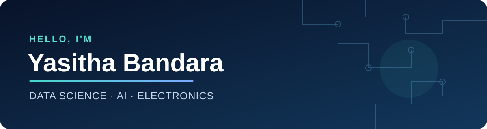

  

  <a href="https://www.linkedin.com/in/yasithabandara/">LinkedIn</a> &nbsp;•&nbsp;
  <a href="https://github.com/YB-8080?tab=repositories">Explore my projects</a>

<h3 align="center">Turning ideas into intelligent, connected solutions.</h3>

I’m **Yasitha Bandara**, an engineer with a passion for combining electronics, data science and software. I enjoy taking an idea from sensors and circuits through to models, dashboards and applications that people can use.

🎓 My learning journey includes data science and AI at the **University of Moratuwa**, alongside hands-on electronics and software projects.

## 🚀 Featured work

| Project | What it explores |
|:--|:--|
| 🔥 **Intelligent Fire Risk Detection** | IoT sensor data, time-series forecasting and anomaly detection for fire-risk monitoring. The repository is private. |
| 🌱 [**Tomato Irrigation Data Mining**](https://github.com/YB-8080/miniproject_258723G) | Visualizing irrigation data and exploring patterns with clustering and outlier detection. |
| 📱 [**TakeEase**](https://github.com/YB-8080/takeease) | An Android task management app with reminders and local data storage. |

I’ve also worked on a **Smart Organic Fertilizer System**, using soil sensors to support irrigation and fertilizer management.

## 🧰 My toolkit

**Data & AI** &nbsp; Python · Jupyter · pandas · scikit-learn · PyTorch · XGBoost · R  
**Electronics & IoT** &nbsp; ESP32 · Arduino · sensors · embedded C/C++  
**Applications & insights** &nbsp; Android · Kotlin · web development · Power BI

## 📚 Learning beyond the classroom

- AWS Academy Graduate — **Data Engineering**
- NVIDIA — **Fundamentals of Accelerated Data Science**
- Sharing technology through community and volunteering, including the Electronics Students’ Society and Leo and Rotaract activities.

  <strong>Curious about a project or interested in collaborating?</strong> 
  <a href="https://www.linkedin.com/in/yasithabandara/">Connect with me on LinkedIn →</a>

